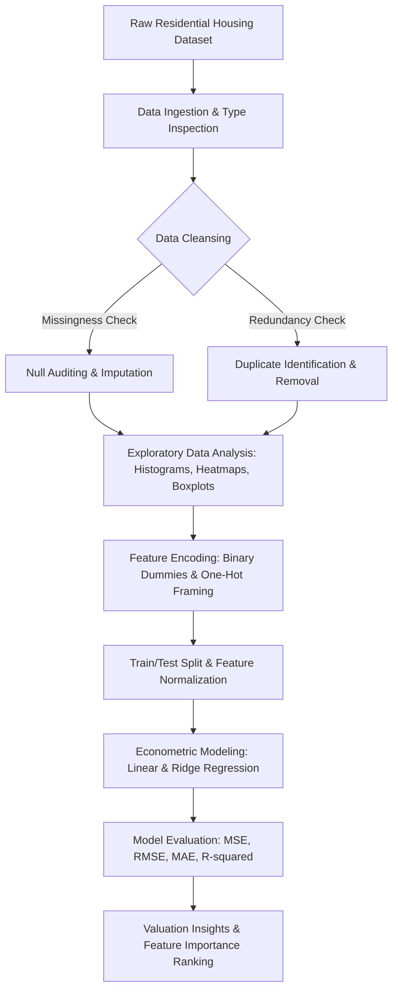

<div align="center">


[](https://www.python.org/)
[](https://pandas.pydata.org/)
[](https://scikit-learn.org/)
[](https://seaborn.pydata.org/)
[](https://jupyter.org/)
[](#)

</div>

---

## 📌 Executive Summary / Overview

The **Real Estate Valuation & Econometrics Pipeline** (`IDS-SDS`) is an exhaustive 52-cell statistical data science study investigating residential property price determinants. Conducted under the curriculum of Introduction to Data Science (IDS) and Statistical Data Science (SDS), the project formulates an end-to-end econometric modeling framework: from raw structural housing feature parsing to multivariate regression analysis.

Real estate prices demonstrate strong non-linear interactions across spatial dimensions (square footage, preferential neighborhood status), architectural configurations (number of bedrooms, stories, basement availability), and infrastructural amenities (air conditioning, hot water heating, parking capacity). This repository establishes disciplined data preprocessing standards—missing value audits, duplicate detection, categorical encoding, and collinearity diagnostics—culminating in predictive hedonic pricing models.

---

## 📖 Interactive Table of Contents

- [Executive Summary / Overview](#-executive-summary--overview)
- [Key Features & Capabilities](#-key-features--capabilities)
- [Econometric Feature Hierarchy](#-econometric-feature-hierarchy)
- [System Architecture & Data Pipeline](#-system-architecture--data-pipeline)
- [Tech Stack Breakdown](#-tech-stack-breakdown)
- [Reproducible Quickstart & Setup](#-reproducible-quickstart--setup)
- [Project Directory Layout](#-project-directory-layout)
- [Author & Contributions](#-author--contributions)

---

## ✨ Key Features & Capabilities

- **Rigorous Data Quality Protocol**: Systematically scans 500+ residential observations for null values, duplicates, and type irregularities, executing targeted deduplication (`df.drop_duplicates()`).
- **Hedonic Price Modeling**: Evaluates marginal willingness-to-pay for structural variables (lot area, bedrooms, bathrooms) and convenience amenities (main road access, guest room, basement).
- **Comprehensive Visual EDA**: Generates multi-panel Seaborn pairplots, correlation matrices, and boxplots analyzing price spreads conditioned on furnishing status (furnished, semi-furnished, unfurnished).
- **Multivariate Linear & Ridge Regression**: Fits predictive models with Scikit-Learn to estimate fair market property values with residual diagnostics.
- **Statistical Significance Testing**: Computes coefficient standard errors, p-values, and $R^2$ goodness-of-fit to validate econometric hypotheses.

---

## 🏡 Econometric Feature Hierarchy

| Feature Name | Type | Description |
| :--- | :--- | :--- |
| `Price` | Target (Continuous) | Transaction sale price of the residential property |
| `Area` | Independent (Continuous) | Total square footage / lot area |
| `Bedrooms` | Discrete | Total number of dedicated bedrooms |
| `Bathrooms` | Discrete | Total number of bathrooms |
| `Stories` | Discrete | Number of architectural floors/stories |
| `Mainroad` | Binary Categorical | Proximity / frontage on a primary municipal thoroughfare |
| `Guestroom` | Binary Categorical | Presence of auxiliary guest quarters |
| `Basement` | Binary Categorical | Finished or unfinished basement structure |
| `Hotwaterheating`| Binary Categorical | Centralized hot water heating infrastructure |
| `Airconditioning`| Binary Categorical | Centralized or ductless HVAC system installed |
| `Parking` | Discrete | Number of off-street parking bays/garages |
| `Prefarea` | Binary Categorical | Location within a preferential high-demand urban zone |
| `Furnishingstatus`| Multi-class Nominal | Furnished, Semi-Furnished, or Unfurnished |

---

## 🏗️ System Architecture & Data Pipeline



---

## 🛠️ Tech Stack Breakdown

| Category | Technologies & Tools |
| :--- | :--- |
| **Language** | Python 3.9+ |
| **Data Processing** | Pandas (DataFrames, GroupBy, Indexing), NumPy |
| **Statistical Modeling** | Scikit-Learn (LinearRegression, Ridge, TrainTestSplit, Metrics) |
| **Visualization Suite** | Seaborn, Matplotlib (Distribution Plots, Heatmaps, Pairplots) |
| **Interactive Computing** | Jupyter Notebook |

---

## 🚀 Reproducible Quickstart & Setup

### Prerequisites
- Python 3.9+
- Jupyter Notebook or Jupyter Lab

### Installation
```bash
# Clone the repository
git clone https://github.com/Jeshwanthika07/IDS-SDS.git
cd IDS-SDS

# Create virtual environment
python -m venv venv
# On Windows:
.\venv\Scripts\activate
# On Linux/macOS:
source venv/bin/activate

# Install required scientific libraries
pip install numpy pandas scikit-learn matplotlib seaborn jupyterlab
```

### Launching the Analysis
```bash
jupyter lab "IDS AND SDS.ipynb"
```
Execute the cells sequentially to reproduce the data cleaning steps, exploratory statistical charts, and regression models.

---

## 📂 Project Directory Layout

```text
IDS-SDS/
│
├── IDS AND SDS.ipynb          # 52-cell end-to-end econometric housing valuation pipeline
└── README.md                  # Comprehensive statistical analysis documentation
```

---

## 👩‍💻 Author & Contributions

Authored by **[Jeshwanthika Pothamchetty](https://github.com/Jeshwanthika07)**  
*Alliance University | Department of Computer Applications*

<div align="center">


</div>
